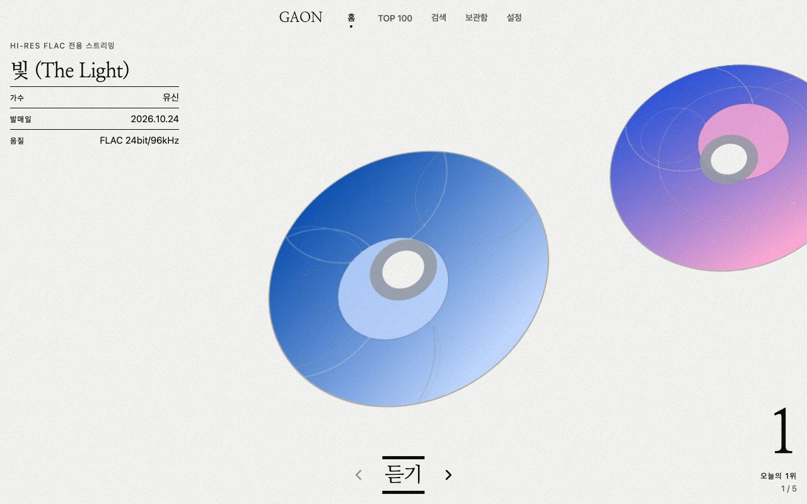
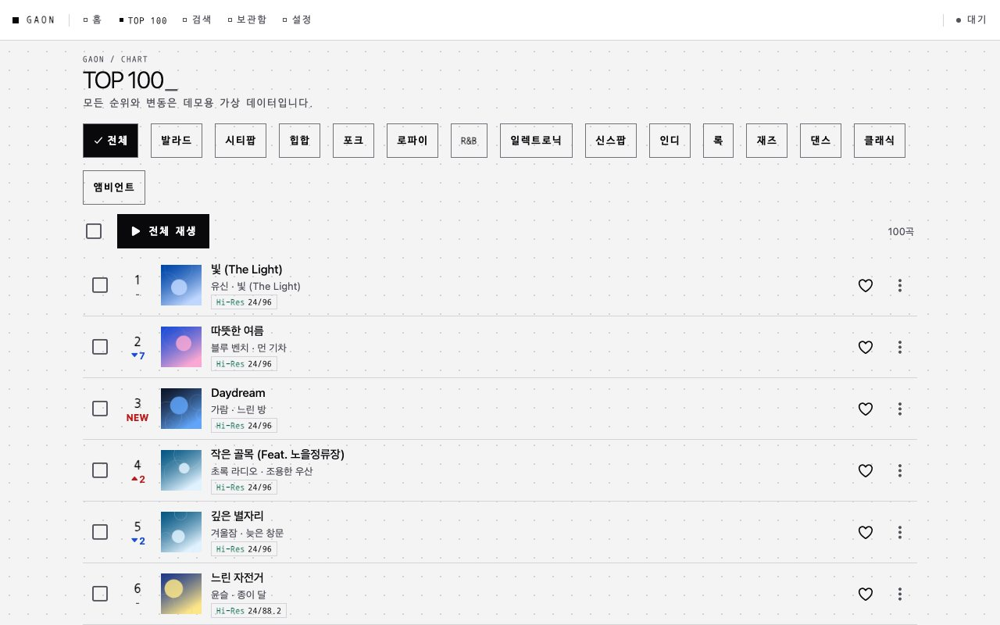
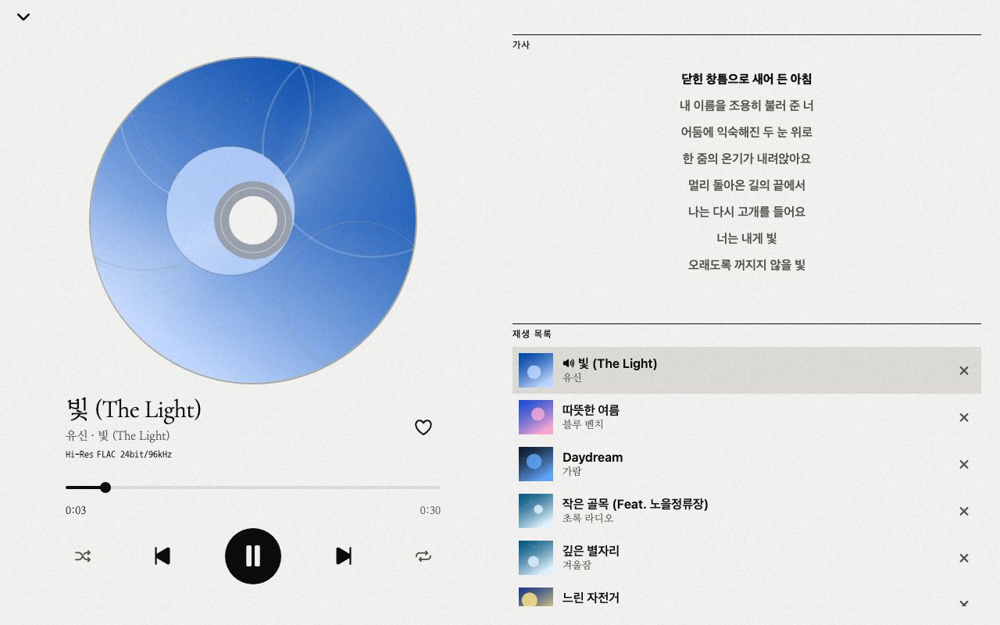
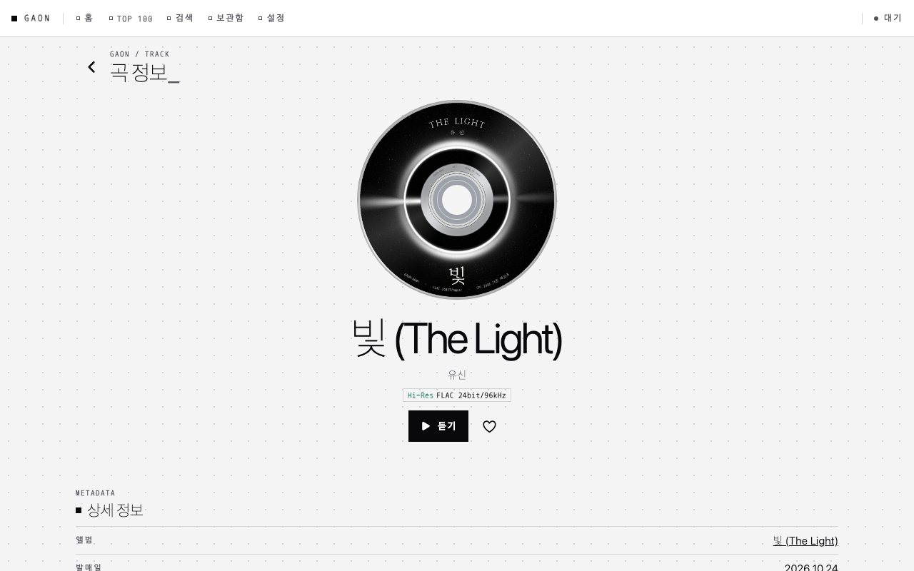
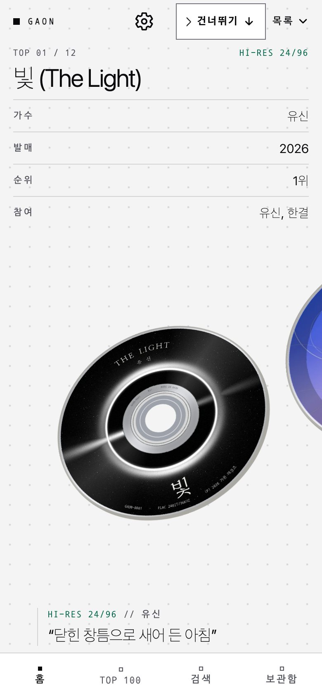
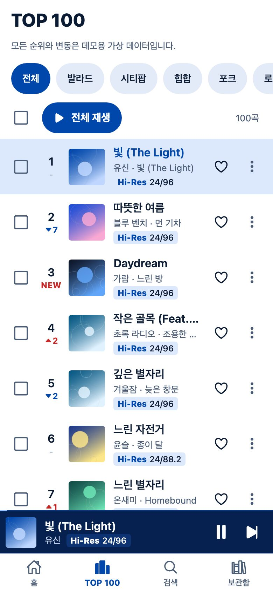
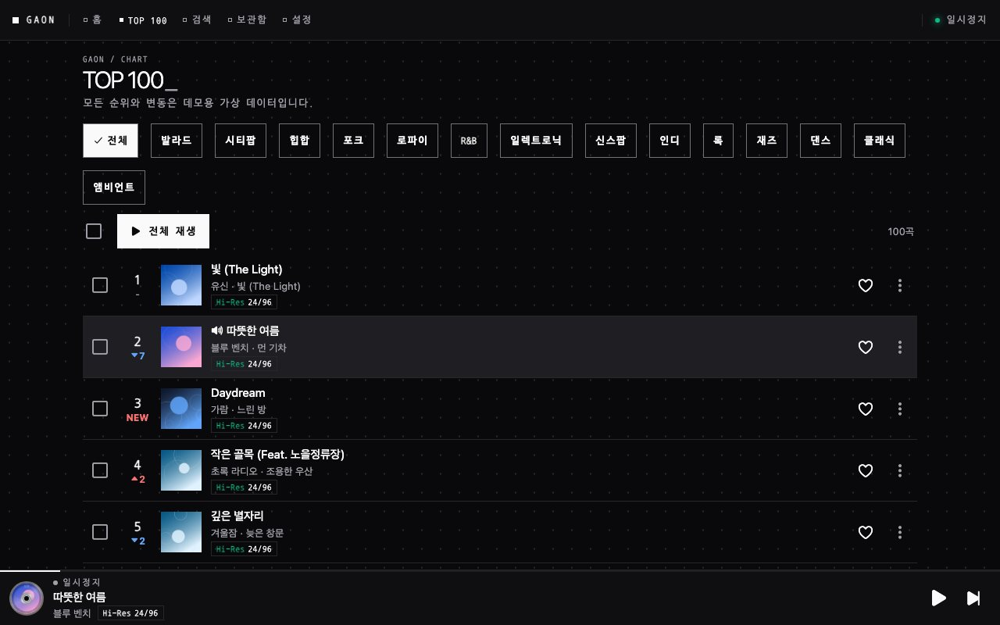
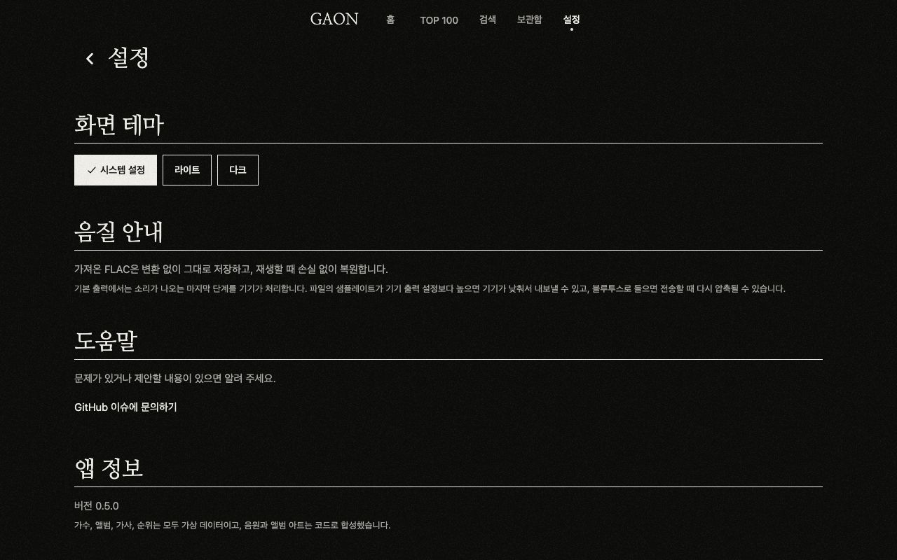
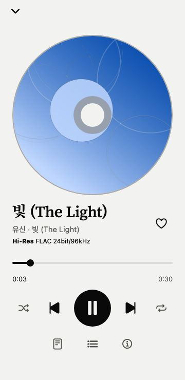

# GAON - 고해상도 음악 스트리밍

[](https://github.com/ryushin01/GAON/actions/workflows/ci.yml)


손실 압축 없이 Hi-Res FLAC만 스트리밍하는 음악 앱입니다. iOS, Android, Windows, macOS에 설치해 들을 수 있고, 기기에 있는 FLAC 파일도 가져와 재생합니다.

**[웹 데모 바로 보기](https://ryushin01.github.io/GAON/)** · **[PC 설치본 내려받기](https://github.com/ryushin01/GAON/releases/latest)** (Windows, macOS)

> **프로젝트 상태:** 포트폴리오 프로젝트입니다. 백엔드 없이 정적 카탈로그와 FLAC 파일을 내려받아 동작합니다. 가수, 앨범, 가사, 순위는 모두 가상 데이터이고, 음원과 앨범 아트는 코드로 합성했습니다.

## 화면

화면의 가수, 곡, 가사, 순위는 모두 가상 데이터입니다.

| 홈 | TOP 100 |
|---|---|
|  |  |

| 플레이어 | 곡 정보 |
|---|---|
|  |  |

| 모바일 홈 | 모바일 TOP 100 |
|---|---|
|  |  |

| 다크 테마 | 설정 |
|---|---|
|  |  |

| 모바일 플레이어 | 내 FLAC |
|---|---|
|  |  |

## 주요 기능

| 기능 | 내용 |
|---|---|
| Hi-Res 스트리밍 | 24bit 88.2kHz, 96kHz, 192kHz FLAC 재생, 곡마다 음질 표시 |
| TOP 100 | 순위와 변동, 신규 진입 표시, 장르 필터, 전체·선택 재생 |
| 플레이어 | 셔플, 반복, 재생 위치 이동, 가사 따라가기, 재생 목록 편집, 백그라운드 재생 |
| 내 FLAC | 기기의 FLAC을 변환 없이 앱 안에 저장, 태그와 음질 분석, 인터넷 없이 재생 |
| 비트 퍼펙트 출력 | PC 앱 독점 출력, 곡마다 장치 샘플레이트 전환 (macOS Core Audio, Windows WASAPI) |
| 테마 | 라이트, 다크, 시스템 설정 따르기 |
| 보관함 | 좋아요, 최근 재생, 플레이리스트 (앱을 다시 켜도 유지) |
| 계정 | 카카오·Google·GitHub 소셜 로그인 구현 (공개 데모는 데모 로그인), 소유자 계정은 비공개 Gist로 보관함 동기화 |
| 카탈로그 | 곡·앨범·가수 상세, 피처링과 작사·작곡·편곡 크레딧, 통합 검색 |
| 접근성 | 키보드 조작, 본문 바로가기, 스크린 리더 이름, 색과 무관한 순위 변동 표시 |

FLAC은 변환 없이 저장하고 손실 없이 디코딩합니다. PC 앱은 설정에서 비트 퍼펙트 출력을 켜면 운영체제 믹서를 거치지 않고 장치로 보내고, 실제 출력 상태를 플레이어에 표시합니다. 모바일과 웹의 마지막 출력은 운영체제가 처리합니다. 자세한 내용은 [음질](docs/development.md#음질)을 참고하세요.

## 기술 스택


| 구분 | 사용 기술 |
|---|---|
| 앱 | Expo 58, React Native 0.88, React 19, Expo Router, TypeScript |
| 오디오·파일 | expo-audio, expo-document-picker, expo-file-system |
| 상태·데이터 | TanStack Query v5, Zustand |
| 로그인·동기화 | Supabase (Auth, Postgres) |
| 스타일 | react-native-unistyles 3 |
| PC 앱 | Electron 45, electron-builder, C (miniaudio, Core Audio, WASAPI) |
| 품질 | ESLint, Jest, Storybook 10, Playwright, axe |
| 데모 데이터 | Python (numpy, soundfile, Pillow) |
| 배포 | GitHub Actions, GitHub Pages |

## 시작하기

Node.js 22(`.nvmrc`), pnpm 12, Python 3이 필요합니다. 네이티브 빌드에는 Xcode 또는 Android Studio가 더 필요합니다.

```bash
nvm use
corepack enable pnpm
pnpm install
pip install numpy soundfile pillow
pnpm media:generate                               # 카탈로그와 FLAC 생성
pnpm media:serve                                  # http://localhost:8787
echo 'EXPO_PUBLIC_MEDIA_BASE_URL=http://localhost:8787' > .env.local
pnpm web                                          # 또는 pnpm ios, pnpm android
```

| 명령 | 설명 |
|---|---|
| `pnpm build:web` / `pnpm desktop` | 웹 빌드 / 그 빌드를 PC 앱으로 실행 |
| `pnpm build:desktop` | PC 설치본 빌드 |
| `pnpm build:native` / `test:native <FLAC>` | 비트 퍼펙트 재생기 빌드 / 무손실 검사 (clang 필요) |
| `pnpm lint` / `typecheck` / `test` | ESLint / 타입 검사 / 단위 테스트 |
| `pnpm lint:fsd` | Feature-Sliced Design 구조 검사 (Steiger) |
| `pnpm test:e2e` | 프로덕션 웹 빌드의 화면·접근성 검사 (먼저 `build:web` 필요) |
| `pnpm test:desktop` | 설치본 실행 검사 (`GAON_EXECUTABLE` 필요) |
| `pnpm storybook` | Storybook (`http://localhost:6006`) |

## 프로젝트 구조

[Feature-Sliced Design](https://feature-sliced.design)을 따릅니다.

```
app/             Expo Router 라우트 (_pages를 다시 내보내기만 합니다)
electron/        PC 앱 셸
native/          비트 퍼펙트 재생기 (C)
e2e/             E2E 테스트
scripts/         데모 미디어 생성과 로컬 서버
src/
├─ _app/         앱 초기화와 루트 레이아웃
├─ _pages/       화면
├─ widgets/      앱 셸, 곡 목록, 플레이어 패널
├─ features/     재생, FLAC 가져오기, 좋아요, 보관함 동기화
├─ entities/     음악 카탈로그, 보관함, 로그인 상태
└─ shared/       UI, 설정, FLAC 파서
```

## 문서

| 문서 | 내용 |
|---|---|
| [개발 가이드](docs/development.md) | 환경 변수, 데모 미디어, 네이티브 빌드, 테스트와 접근성 기준 |
| [CI · 배포](docs/ci-deploy.md) | GitHub Actions, 공개 미디어, PC 설치본 |
| [로그인과 동기화](docs/auth.md) | Supabase와 카카오·Google·GitHub 로그인 설정, 동기화 규칙 |
| [버전 기록](CHANGELOG.md) | 버전별 변경 내용 |
