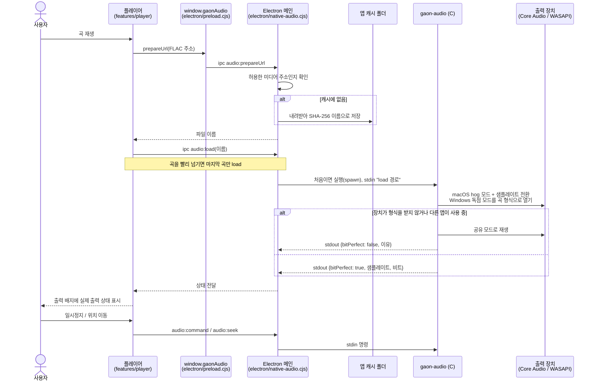
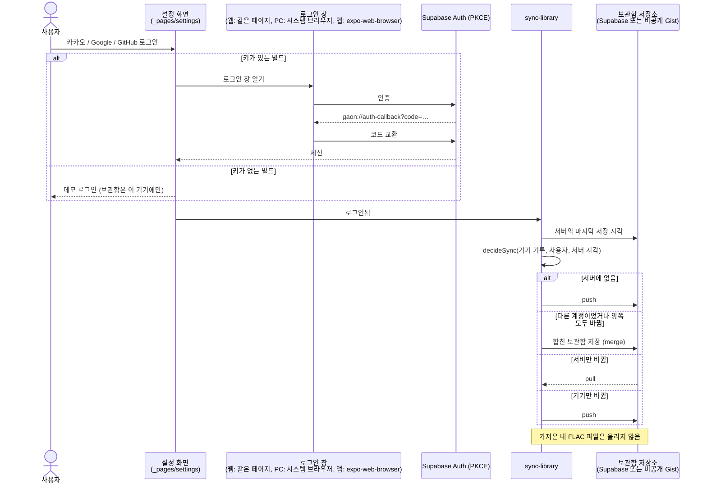
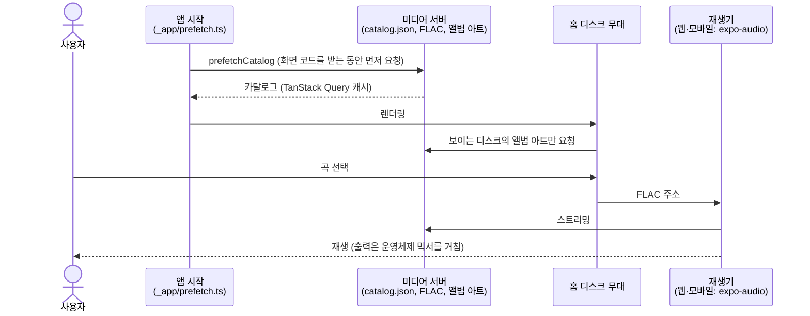

# 시퀀스 다이어그램

GAON의 주요 흐름입니다. 코드 위치는 저장소 루트 기준입니다.

## 1. 비트 퍼펙트 재생 (PC 앱)

설정에서 **비트 퍼펙트 (독점)** 를 켜면 Chromium 대신 `native/gaon-audio` 재생기가 소리를 냅니다.

## 2. 로그인과 보관함 동기화

빌드에 Supabase 키가 있으면 실제 소셜 로그인, 없으면 데모 로그인이나 소유자 로그인(GitHub 토큰, 비공개 Gist)으로 동작합니다.

## 3. 첫 화면과 스트리밍

